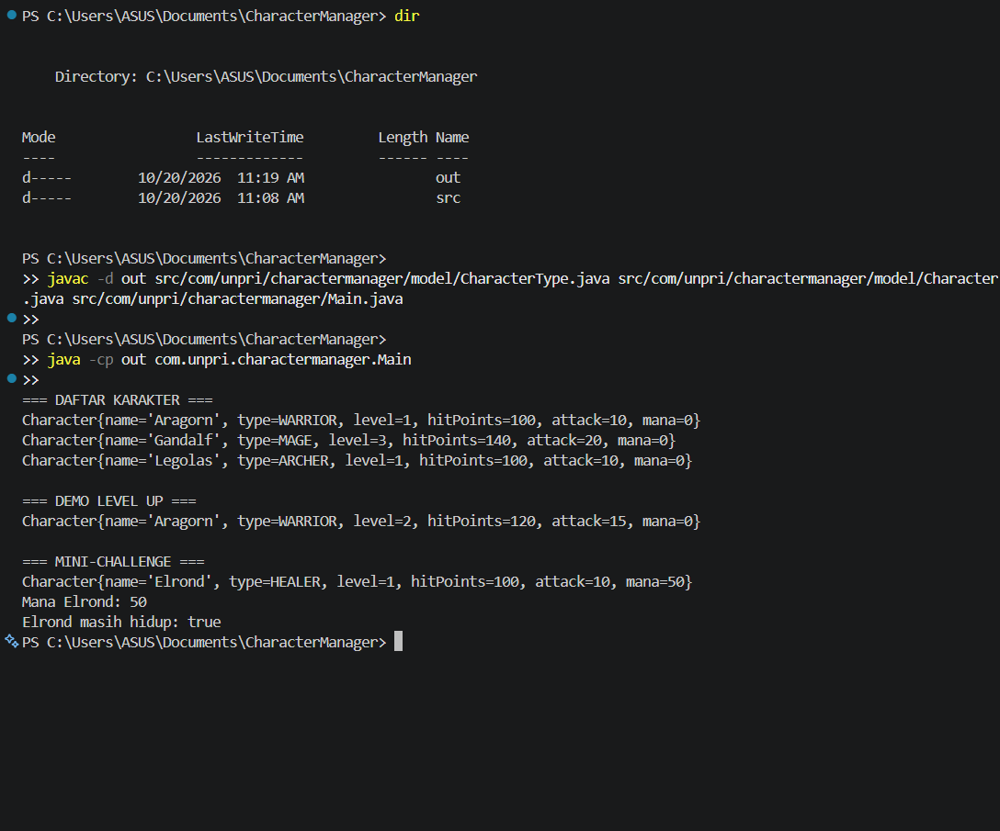
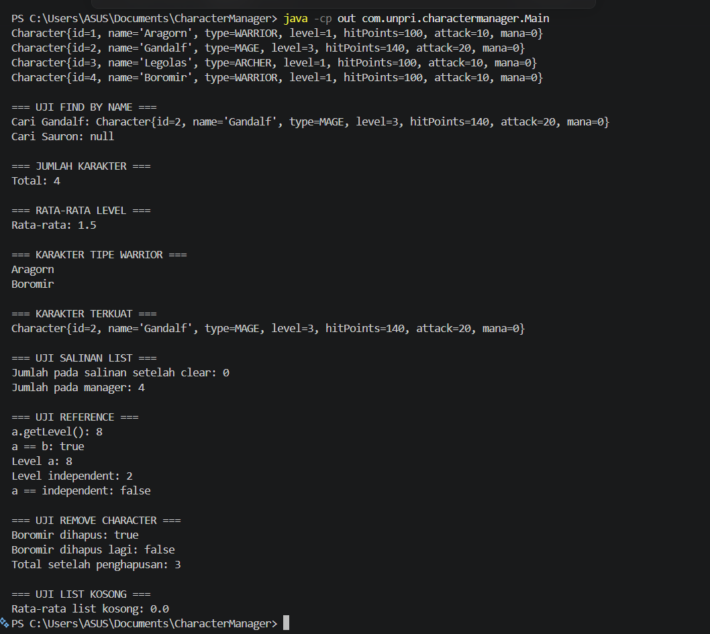
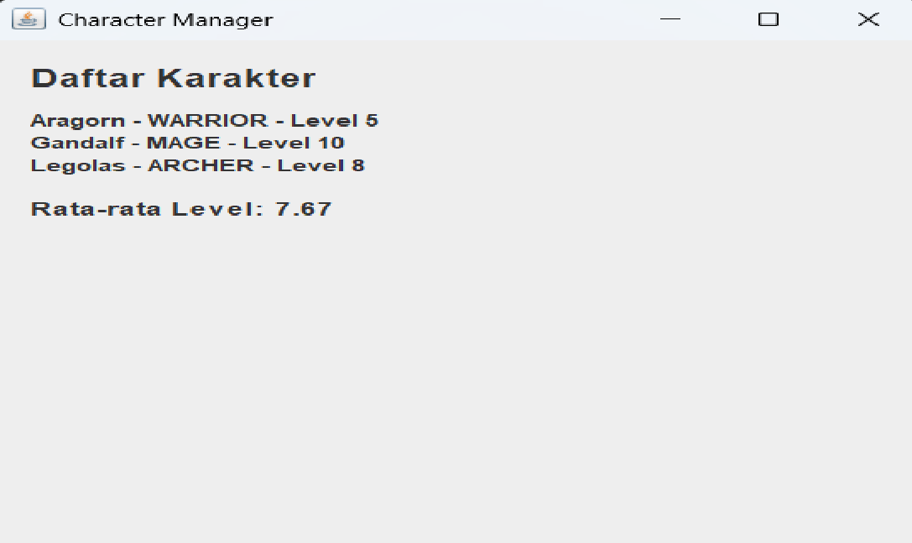
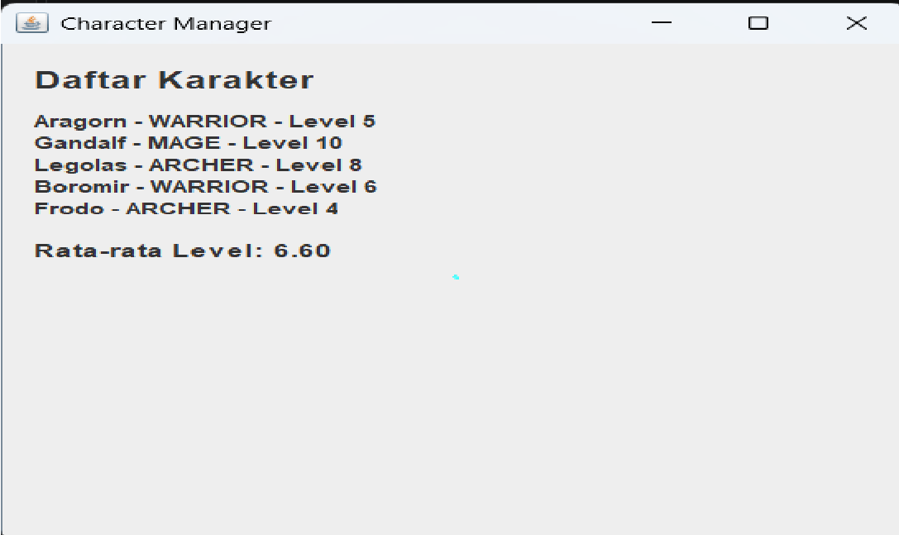
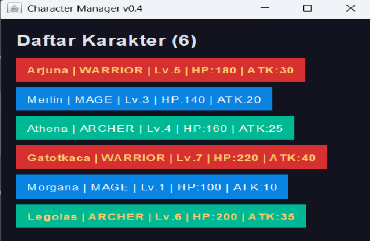
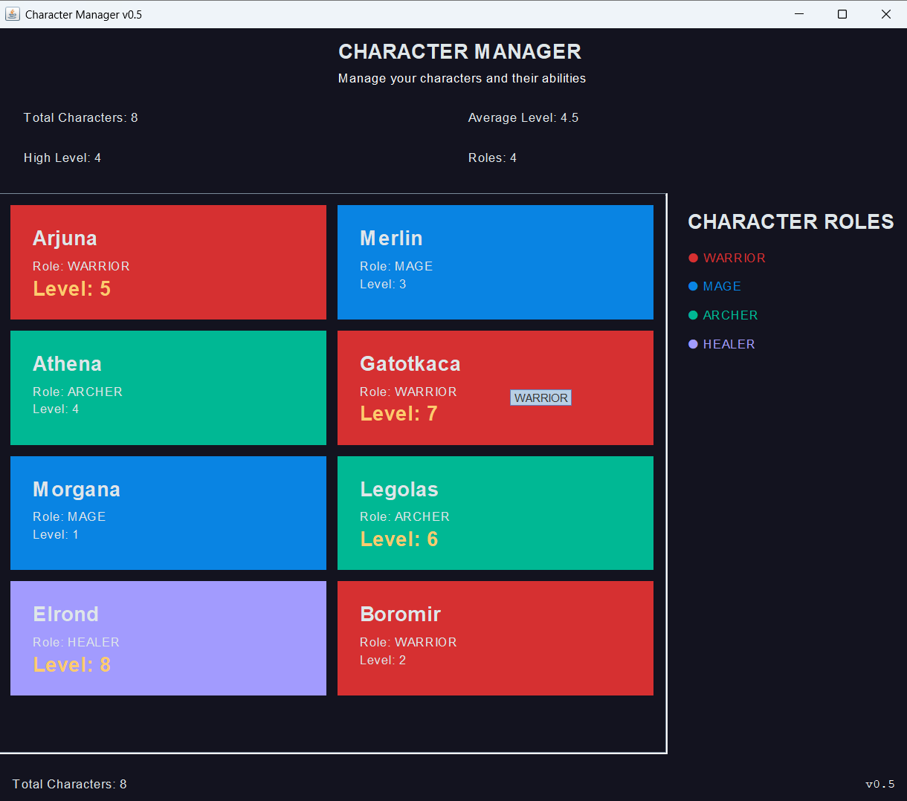
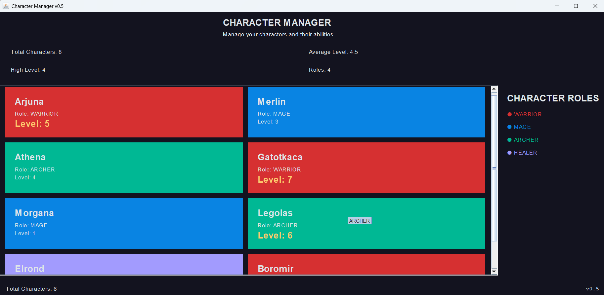
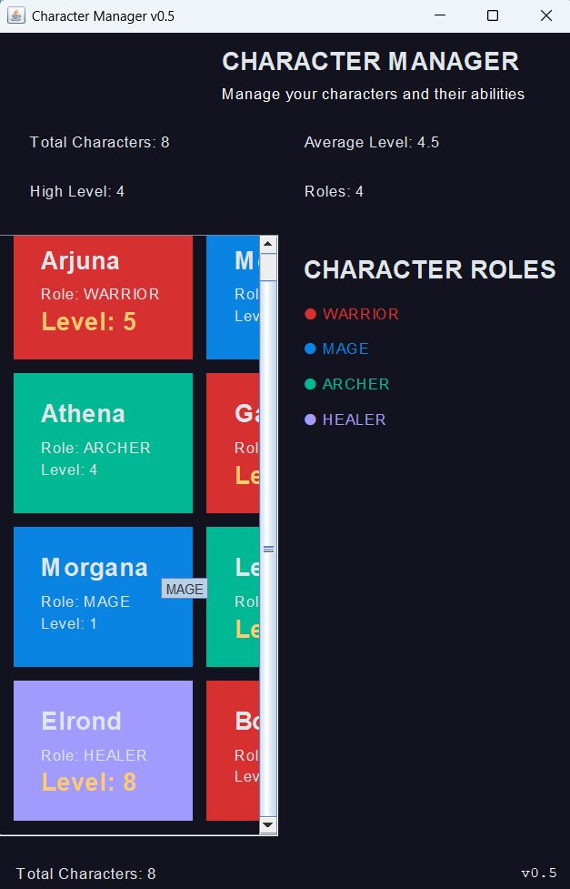

# Character Manager — TP3 (Java Visual SIH-6406)

## Deskripsi
Project ini dibuat menggunakan bahasa Java untuk mengelola karakter. Program menerapkan class Character, enum CharacterType, dua constructor, getter dan setter, serta fitur level up, mana, dan pemeriksaan status hidup menggunakan isAlive().

## Screenshot Output



## Struktur Folder

```text
CharacterManager/
├── src/
│   └── com/
│       └── unpri/
│           └── charactermanager/
│               ├── Main.java
│               └── model/
│                   ├── Character.java
│                   └── CharacterType.java
├── screenshots/
│   └── output.png
├── README.md
└── .gitignore
```

## Identitas Mahasiswa
- Nama lengkap: Abil Febrian Panggabean
- NIM: 253303621266
- Google Docs Bagian D: https://docs.google.com/document/d/1wfWgJsuUar71cdxEwOaybO1XTEGKyPr11RCBjcizp9o/edit?usp=sharing


## TP5 — CharacterManager

### Fitur yang Diimplementasikan

1. `addCharacter()` menambahkan karakter jika nama belum terdaftar.
2. `findByName()` mencari karakter berdasarkan nama.
3. `removeCharacter()` menghapus karakter berdasarkan nama.
4. `getTotalCharacters()` menghitung jumlah karakter yang tersimpan.
5. `getAllCharacters()` mengembalikan salinan ArrayList.
6. `getAverageLevel()` menghitung rata-rata level dan mengembalikan 0 jika list kosong.
7. `findByType()` mencari semua karakter berdasarkan tipe.
8. `findStrongest()` mencari karakter dengan nilai attack tertinggi.

### Fitur Baru Bagian C: findStrongest()

Method `findStrongest()` mencari karakter dengan nilai attack paling tinggi dari daftar karakter yang tersimpan. Method ini mengembalikan objek karakter dengan attack tertinggi. Jika daftar kosong, method mengembalikan `null`.

Method ini tidak mengubah daftar karakter dan tidak mengekspos ArrayList internal, sehingga struktur data CharacterManager tetap terjaga.

### Pengujian

Pengujian dilakukan melalui Main.java, meliputi penambahan karakter, penolakan nama duplikat, pencarian dan penghapusan karakter, rata-rata level, pencarian tipe, salinan ArrayList, serta eksperimen reference.

### Screenshot Output


### Analisis Reference dan Rancangan

Dokumen Google Docs: https://docs.google.com/document/d/1WKXGvrMSgYoM_9AsWkLYff1ITNmU3Cim8fgmN8RURWU/edit?usp=sharing


## TP8 — Java Visual

### Screenshot Sebelum dan Sesudah

**Sebelum penambahan karakter:**



**Sesudah penambahan karakter:**


### Implementasi GUI

Program menggunakan Java Swing untuk menampilkan data karakter melalui MainWindow. Daftar karakter dibuat secara dinamis menggunakan perulangan, sedangkan statistik rata-rata level dihitung berdasarkan data yang tersimpan dalam CharacterManager.

### Aliran Data dan MVC

Main.java membuat data karakter dan memulai GUI menggunakan SwingUtilities.invokeLater(). CharacterManager mengelola daftar karakter serta menyediakan informasi jumlah dan rata-rata level. MainWindow bertanggung jawab menampilkan data karakter ke dalam JLabel. Pembagian tanggung jawab tersebut berkaitan dengan konsep MVC karena pengelolaan data dan tampilan dipisahkan.

### Karakter Baru

- Boromir — tipe WARRIOR, level 6. Dipilih sebagai karakter bertipe petarung dengan level yang berbeda dari Aragorn.
- Frodo — tipe ARCHER, level 4. Dipilih untuk menambah variasi karakter dan menggunakan level yang lebih rendah daripada karakter lainnya.

### Analisis GUI dan MVC

Dokumen Google Docs:(https://docs.google.com/document/d/1WKXGvrMSgYoM_9AsWkLYff1ITNmU3Cim8fgmN8RURWU/edit?usp=sharing)


## TP10 — AppTheme dan MainWindow v0.4

### Screenshot Sebelum (v0.3)



### Screenshot Sesudah (v0.4)



### Pemisahan Tema dan Model

Warna tampilan disimpan di AppTheme karena pengaturan warna termasuk tanggung jawab View dalam pola MVC. Character sebagai Model bertugas menyimpan dan menyediakan data karakter, seperti nama, role, dan level. Jika warna disimpan di Character, Model akan bergantung pada kebutuhan tampilan sehingga pemisahan tanggung jawab menjadi kurang baik. Dengan AppTheme, perubahan warna dapat dilakukan pada satu tempat tanpa mengubah data karakter.

### Dua Properti Tambahan

1. **Tooltip:** setToolTipText() menampilkan keterangan role saat kursor diarahkan ke kartu. Properti ini membantu pengguna memahami karakter tanpa menambah teks panjang pada tampilan utama.
2. **Cursor:** setCursor() mengubah kursor menjadi bentuk tangan saat berada di atas kartu. Properti ini memberikan penanda visual saat pengguna mengarahkan kursor ke kartu.

### Mini-Challenge

Karakter dengan level minimal 5 ditampilkan menggunakan teks emas dan tebal. Batas level disimpan pada konstanta HIGH_LEVEL_THRESHOLD di AppTheme agar nilai batas tidak tersebar di kode tampilan.

### Analisis GUI dan MVC

Dokumen Google Docs:(https://docs.google.com/document/d/1WKXGvrMSgYoM_9AsWkLYff1ITNmU3Cim8fgmN8RURWU/edit?usp=sharing)


# TP12 — Responsive Layout CharacterManager

## 1. Implementasi BorderLayout

Pada TP12, MainWindow dikembangkan menjadi versi v0.5
dengan menggunakan BorderLayout sebagai layout utama.

Empat wilayah yang digunakan:

- NORTH: Header dan panel statistik.
- CENTER: Daftar karakter menggunakan JScrollPane.
- EAST: Legenda role menggunakan BoxLayout Y_AXIS.
- SOUTH: Status bar yang menampilkan total karakter dan versi aplikasi.

## 2. Wireframe Layout

```text
+-------------------------------------------------------+
|                    HEADER (NORTH)                     |
|                 CHARACTER MANAGER                     |
|-------------------------------------------------------|
|                    STATISTICS                         |
|  Total Characters | Average Level                     |
|  High Level       | Total Roles                        |
|-------------------------------------------------------|
|                                |                      |
|          CENTER                |        EAST          |
|                                |                      |
|  +-------------------------+   |  CHARACTER ROLES     |
|  | Arjuna      | Merlin    |   |                      |
|  +-------------------------+   |  WARRIOR              |
|  | Athena      | Gatotkaca |   |  MAGE                 |
|  +-------------------------+   |  ARCHER               |
|  | Morgana     | Legolas   |   |  HEALER               |
|  +-------------------------+   |                      |
|  | Elrond      | Boromir   |   |                      |
|  +-------------------------+   |                      |
|                                |                      |
|-------------------------------------------------------|
| Total Characters: 8                       v0.5        |
|                    SOUTH                              |
+-------------------------------------------------------+
```

## 3. Screenshot Pengujian

### 3.1 Ukuran Awal



### 3.2 Jendela Dilebarkan



### 3.3 Jendela Dikecilkan



## 4. Tabel Pengamatan Resize

| Kondisi | Prediksi | Hasil Pengamatan |
|---|---|---|
| Ukuran awal | Semua komponen terlihat pada posisi masing-masing | Sesuaikan hasil screenshot |
| Jendela dilebarkan | Area CENTER mengikuti pertambahan ruang | Sesuaikan hasil screenshot |
| Jendela dikecilkan | Scrollbar vertikal muncul ketika diperlukan | Sesuaikan hasil screenshot |

## 5. Struktur Panel Bersarang

Aplikasi menggunakan BorderLayout sebagai layout utama
yang membagi tampilan menjadi empat wilayah. Panel NORTH
berisi header dan panel statistik dengan GridLayout 2x2.
Panel CENTER berisi panel pembungkus kartu karakter yang
dimasukkan ke JScrollPane. Panel EAST menggunakan BoxLayout
untuk menyusun legenda secara vertikal, sedangkan panel
SOUTH menggunakan BoxLayout untuk memisahkan teks status
dan versi aplikasi.

## 6. Alasan Pemilihan Layout

Panel statistik menggunakan GridLayout 2x2 karena memiliki
empat informasi yang disusun secara teratur dalam dua baris
dan dua kolom. GridLayout membuat setiap informasi memiliki
ruang yang konsisten.

BoxLayout Y_AXIS dipilih untuk legenda karena setiap role
perlu ditampilkan secara vertikal. FlowLayout tidak dipilih
untuk legenda karena susunan horizontal dapat membuat
legenda kurang teratur ketika ruang berubah.

Untuk daftar karakter digunakan GridLayout dengan dua kolom
agar kartu tersusun rapi. Panel pembungkus menggunakan
BorderLayout dan menempatkan panel kartu di NORTH sebelum
dimasukkan ke JScrollPane.

## 7. Pengujian Package Model

Package model tidak mengalami perubahan pada TP12.
Pengecekan dilakukan menggunakan perintah:

```powershell
git diff -- src/com/unpri/charactermanager/model/
```

## 8. Analisis Layout dan MVC

Dokumen analisis Google Docs:
](https://docs.google.com/document/d/1WKXGvrMSgYoM_9AsWkLYff1ITNmU3Cim8fgmN8RURWU/edit?usp=sharing)

