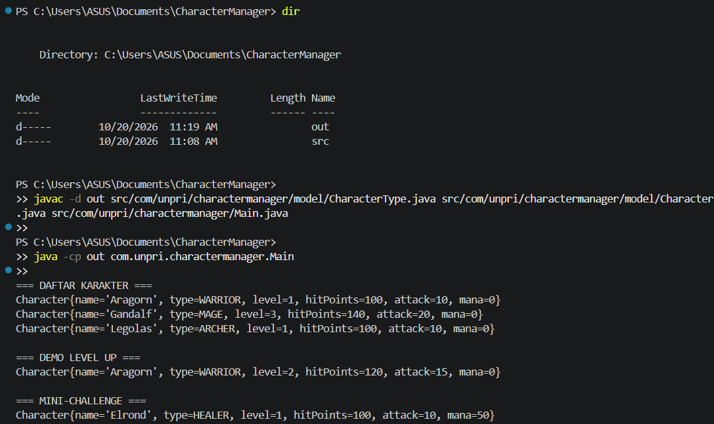

# Character Manager — TP3 (Java Visual SIH-6406)

## Deskripsi
Project ini dibuat menggunakan bahasa Java untuk mengelola karakter. Program menerapkan class Character, enum CharacterType, dua constructor, getter dan setter, serta fitur level up, mana, dan pemeriksaan status hidup menggunakan isAlive().

## Screenshot Output



## Struktur Folder

```text
CharacterManager/
├── src/
│   └── com/
│       └── unpri/
│           └── charactermanager/
│               ├── Main.java
│               └── model/
│                   ├── Character.java
│                   └── CharacterType.java
├── screenshots/
│   └── output.png
├── README.md
└── .gitignore
```

## Identitas Mahasiswa
- Nama lengkap: Abil Febrian Panggabean
- NIM: 253303621266
- Google Docs Bagian D: https://docs.google.com/document/d/1wfWgJsuUar71cdxEwOaybO1XTEGKyPr11RCBjcizp9o/edit?usp=sharing